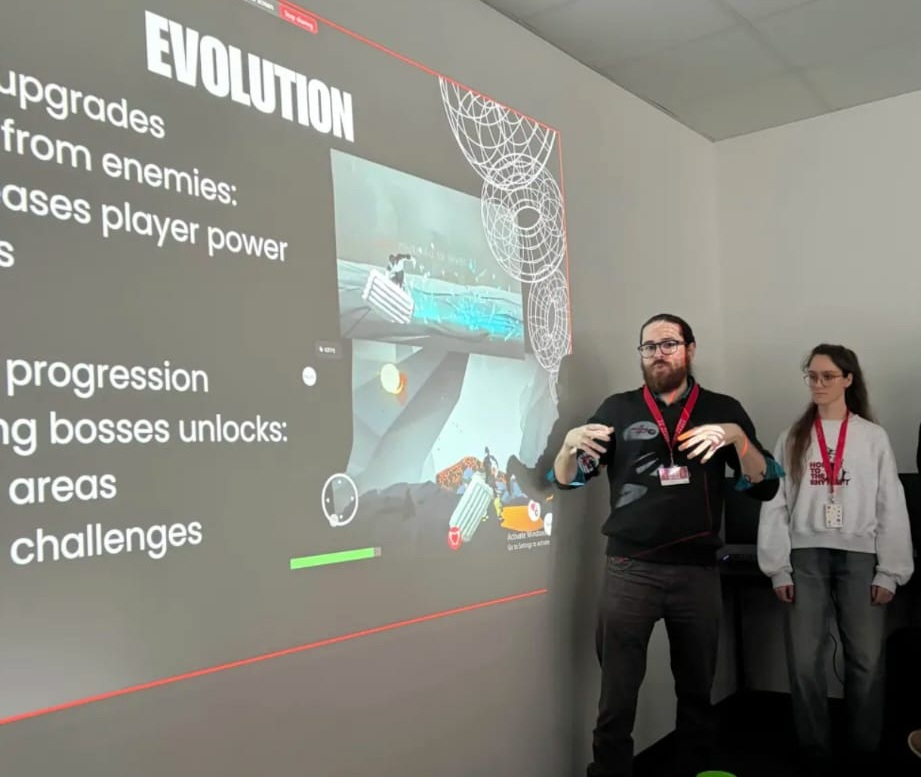

  <aside class="sidebar">
    <a href="index.html" class="btn-back">← Back to portfolio</a>

    

      <h2>Ecdysis</h2>
    

    

      <a href="https://futuregames.itch.io/ecdysis" target="_blank" rel="noopener noreferrer" class="btn btn-primary">
        Download on itch.io ↗
      </a>
    

  </aside>

  <main class="content">
    <section>
      

        <h1>Ecdysis</h1>
        
Case study (draft)

      

      <h2>Development Process</h2>
      
<!-- Add development process notes here. -->

      <h2>Game Concept</h2>
      
<!-- Add game concept notes here. -->

      <h2>Jury Feedback</h2>
      
<!-- Add jury feedback here. -->

      

        
      

    </section>
  </main>

