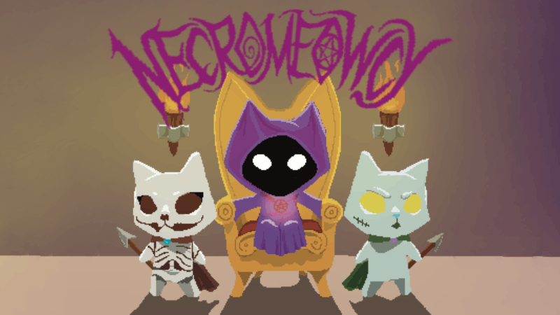
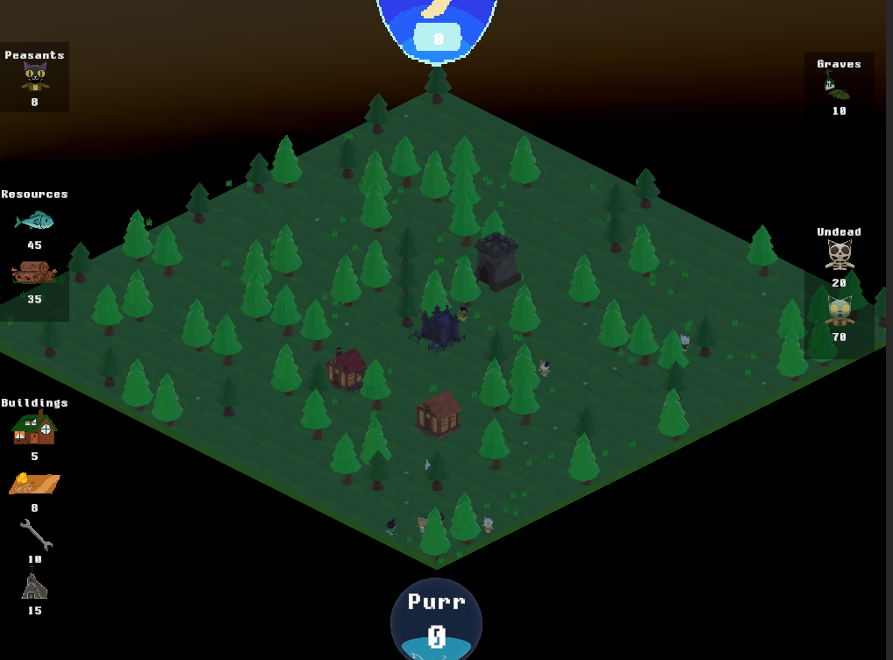
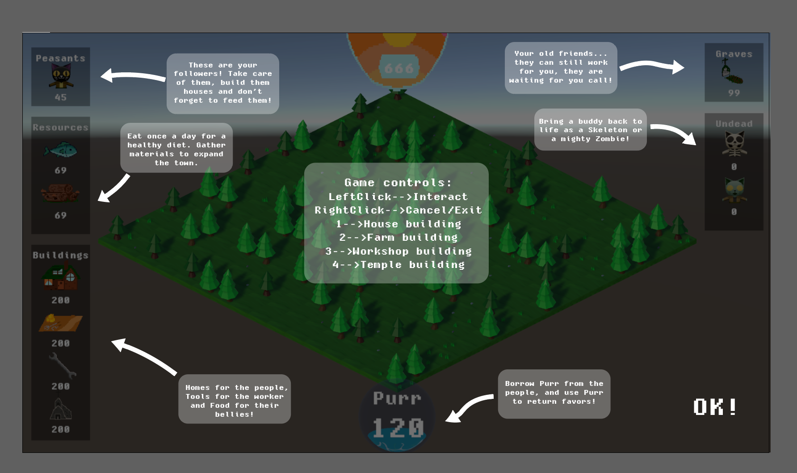
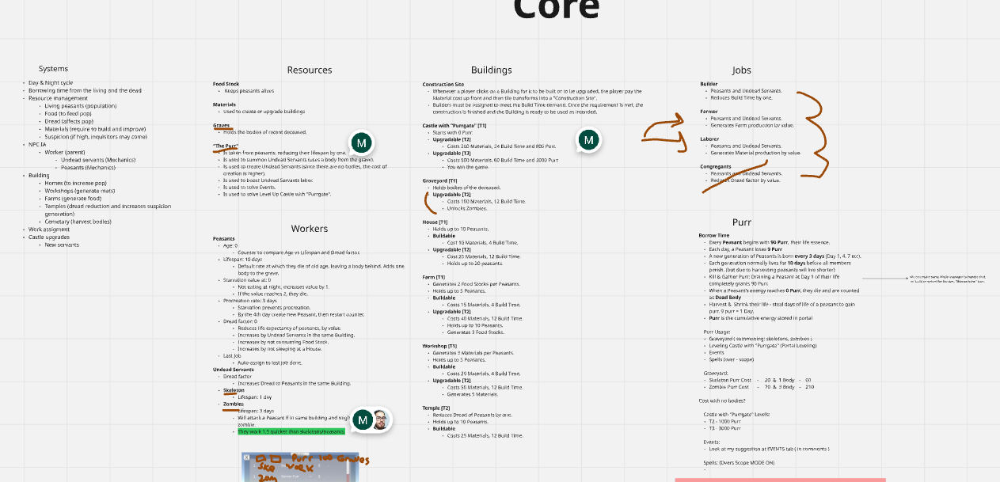
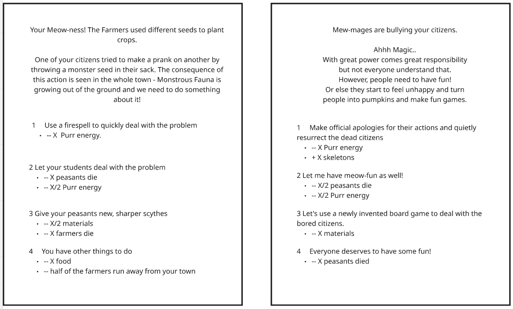
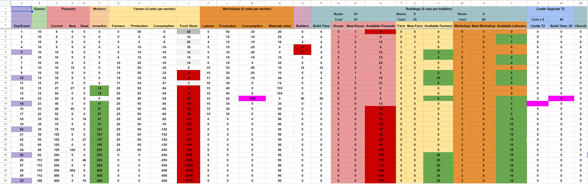

  <aside class="sidebar">
    <a href="index.html" class="btn-back">← Back to portfolio</a>

    

    

      <h2>Necromeowcy</h2>
      
1-Week Game Jam Project

    

    

      <a href="https://untalpanda.itch.io/necromeowcy" target="_blank" rel="noopener noreferrer" class="btn btn-primary">
        Play in Browser ↗
      </a>
      <a href="https://docs.google.com/spreadsheets/d/1D1Q1IpKQHnFNLXhoZSwwbAe1SD5LLhLoceH37spaDj4/edit?usp=sharing" target="_blank" rel="noopener noreferrer" class="btn btn-outline">
        View Economy Spreadsheet ↗
      </a>
    

    

      <h3>Jam Reflections</h3>
      

        Necromeowcy is a city builder created during a one-week game jam. Reflecting on our results, we definitely overscoped and faced time constraints, but learned valuable lessons about economy balance and strategy game UX/UI.
      

    

  </aside>

  <main class="content">
    <section>
      

        <h1>Necromeowcy</h1>
        
A City Builder Built on "Borrowed Time"

        

          

            Jam Theme
            "Borrowed Time"
          

          

            Role
            System & Economy Designer
          

          

            Timeline
            1 week (Game Jam)
          

          

            Genre
            City Builder / Strategy
          

        

      

      <h2>Theme Interpretation: "Borrowed Time"</h2>
      

        At first glance, "Borrowed Time" seemed like an unusual prompt for a strategy game. During our brainstorming sessions, necromancy emerged as a central theme. How could it be subverted? What if the necromancer isn't inherently evil, but uses the dead to serve the living for a strictly limited period of time?
      

      

        
        
<em>In-game town view and citizen management.</em>

      

      <h2>Core Systems & Mechanics</h2>

      

        <h4>1. Living Population Infrastructure</h4>
        

          Before handling the undead, we designed a foundational ecosystem for the living. Players command cat peasants to build houses (increasing population cap), sow farms (producing daily food rations), and erect workshops (generating construction materials). However, if basic needs are neglected, peasants become stressed, shortening their lifespan and filling the local cemetery.
        

      

      

        <h4>2. Undead Labor & The "Purr" Energy Economy</h4>
        

          Deceased peasants buried in the graveyard can be summoned as temporary undead workers. Undead laborers consume no food rations, but their presence in daylight terrifies living citizens. Players must balance night-shift clandestine necromancy against broad-daylight productivity.
        

        

          To prevent summons from becoming overly situational, we designed an energy mechanic called <strong>"Purr"</strong>. Happy citizens produce Purr, but the necromancer can also siphon Purr directly from living peasants, prematurely aging them to fuel rituals. Taking some Purr sustains the town—taking too much is CATastrophic.
        

      

      

        
        
<em>In-game guidance explaining the Purr and summon cycle.</em>

      

      

        
        
<em>Original design whiteboard mapping systems, resources, and dependencies.</em>

      

      

        <h4>3. Dynamic Dilemmas & Narrative Events</h4>
        

          To prevent passive optimization, an event system triggers dilemmas every few in-game days. Players must make hard trade-offs: spend precious Purr to resolve emergencies, sacrifice stockpiled material, or ignore problems and suffer civilian casualties.
        

      

      

        
        
<em>Early event system mock-ups and narrative choices.</em>

      

      <h2>Systemic Economy Modeling</h2>
      

        To balance resource production and attrition, I built a dynamic spreadsheet simulation forecasting daily town metrics: population growth, natural mortality, food consumption, job distribution, inventory deficits, and upgrade thresholds for the Tier 2 Castle.
      

      

        
      

      

        Explore the live spreadsheet calculations:
        <a href="https://docs.google.com/spreadsheets/d/1D1Q1IpKQHnFNLXhoZSwwbAe1SD5LLhLoceH37spaDj4/edit?usp=sharing" target="_blank" rel="noopener noreferrer" class="my-link">
          <strong>Open Necromeowcy Economy Sheet ↗</strong>
        </a>
      

    </section>
  </main>

