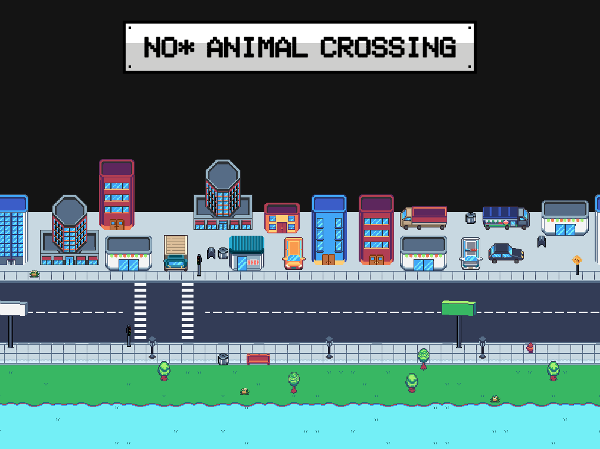
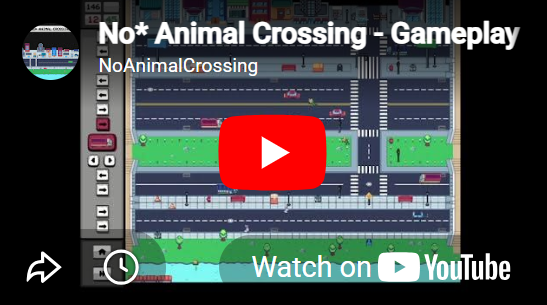
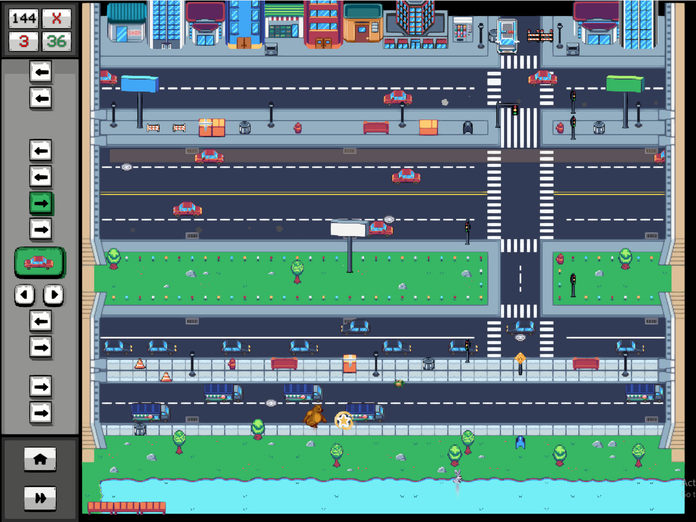
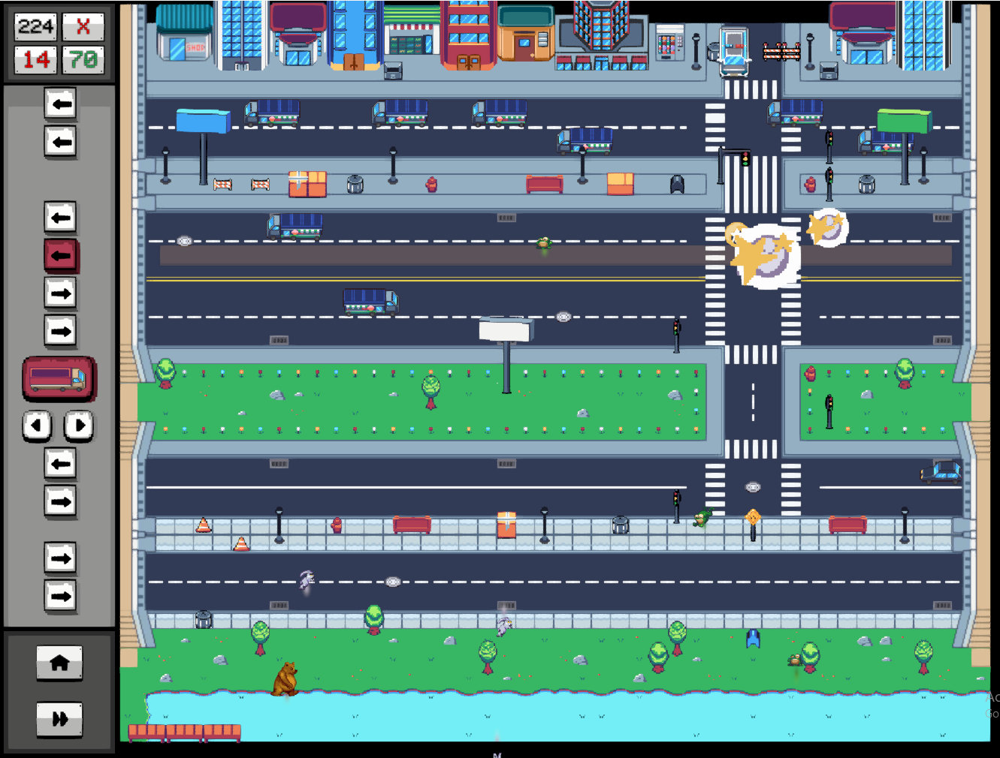
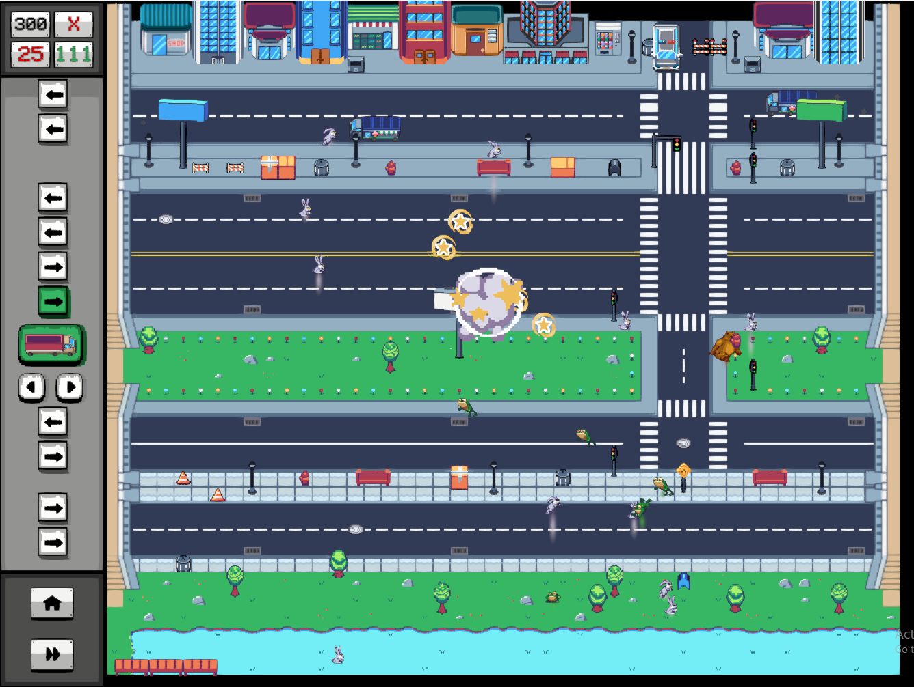
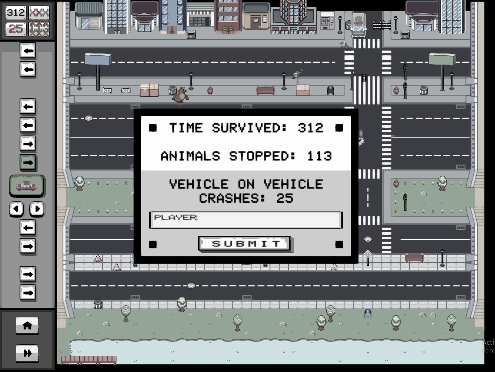
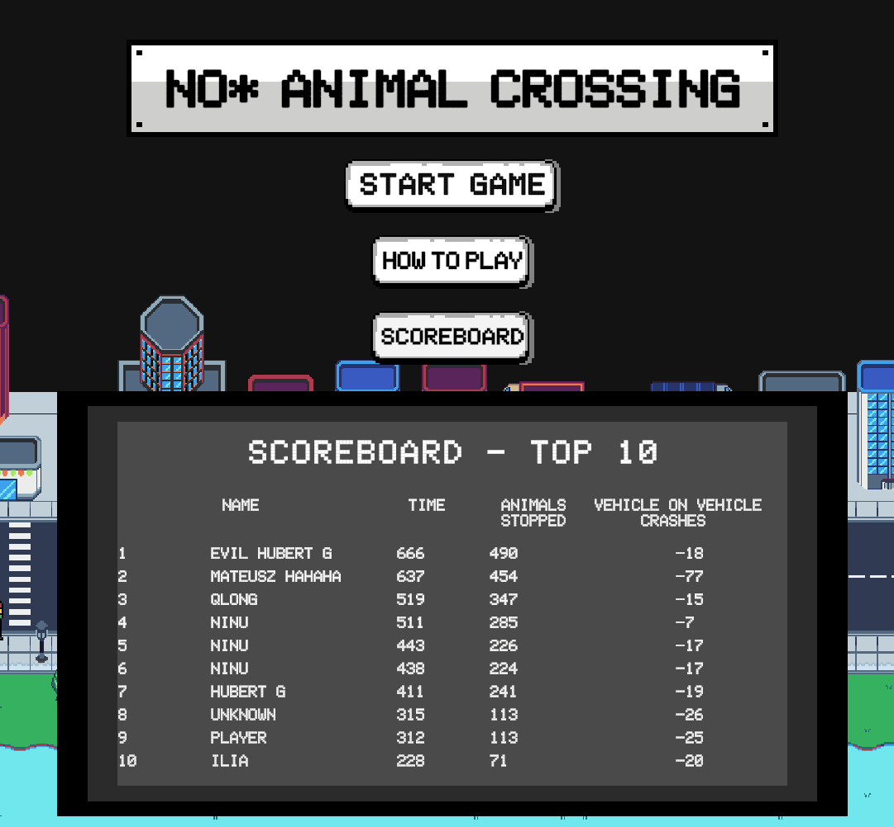

  <aside class="sidebar">
    <a href="index.html" class="btn-back">← Back to portfolio</a>

    

    

      <h2>No* Animal Crossing</h2>
      
Arcade Lane-Defense Survival

    

    

      <a href="https://jpkrohn97.itch.io/no-animal-crossing" target="_blank" rel="noopener noreferrer" class="btn btn-primary">
        Play in Browser ↗
      </a>
      <a href="https://youtu.be/_bysra4bc88" target="_blank" rel="noopener noreferrer" class="btn btn-outline">
        Watch Gameplay ↗
      </a>
    

    

      <h3>Concept Origin</h3>
      

        The first game developed during Futuregames assignments: create a game inspired by arcade classics (Frogger, Pac-Man, etc.). I wondered: <em>What if I inverted Frogger? Instead of playing as the frog, you control the cars to prevent animals from crossing.</em>
      

    

    

      <h3>Gameplay Video</h3>
      
    

  </aside>

  <main class="content">
    <section>
      

        <h1>No* Animal Crossing</h1>
        
An Arcade Lane-Defense Survival Game

        

          

            Engine
            Unity
          

          

            Role
            Solo Game Designer / Programmer
          

          

            Timeline
            1 month
          

          

            Genre
            Arcade / Lane Defense / Score Attack
          

        

      

      <h2>Game Overview</h2>
      

        An experimental arcade survival game where players defend a city by strategically spawning cars to eliminate incoming animals attempting to cross the streets. Inspired by Frogger's movement systems, the game reverses the roles: instead of avoiding traffic, players use traffic as a defensive tool.
      

      

        <h4>Design Problem</h4>
        
How could an arcade classic be reinterpreted into an engaging survival game that encourages strategy and high-scores?

      

      

        <h4>Design Solution</h4>
        <ul>
          <li><strong>Satisfying Skill-Shot:</strong> Rewarding timing and prediction of enemy movement trajectories.</li>
          <li><strong>Strategic Resource Deployment:</strong> Encouraging players to decide when and where to deploy vehicles to maintain continuous lane control under escalating pressure.</li>
        </ul>
      

      <h3>Gameplay Loop</h3>
      

        Early on, players observe enemy movement, predict interception points, and spawn vehicles to eliminate threats before they reach their goal. As the game progresses, pressure increases, requiring both immediate split-second reactions and long-term lane planning across multiple roads.
      

      <h3>Result</h3>
      

        The game creates a steep, satisfying difficulty curve: early gameplay focuses on prediction and positioning, while later stages demand constant traffic flow to eliminate as many enemies as possible, along with quick reactions to deal with critters that slip through defensive gaps. Players are incentivized to optimize their survival strategy and compete for high scores on the leaderboard.
      

      <h2>Gameplay Screenshots</h2>
      

        
        
        
        
      

      <h2>Gameplay Features</h2>

      <h3>Player Vehicles</h3>
      

        The player has access to four distinct vehicles, each with unique speed, durability, cooldown, and tactical purpose. Vehicles can be activated individually to trigger a one-time temporary speed boost, increasing the chances to intercept enemies.
      

      

        

          <h4>Standard Car (Blue)</h4>
          <ul>
            <li>Balanced all-round vehicle</li>
            <li>Resists up to two enemy hits</li>
            <li>Lowest cooldown</li>
            <li>Primary tool for sustained defense and lane control</li>
          </ul>
        

        

          <h4>Fast Car (Red)</h4>
          <ul>
            <li>Highest speed in the game</li>
            <li>Resists one hit</li>
            <li>Higher cooldown than Standard car</li>
            <li>Best used for quick interception</li>
          </ul>
        

        

          <h4>Truck (Blue)</h4>
          <ul>
            <li>Slow but highly durable</li>
            <li>Resists multiple hits</li>
            <li>Can eliminate Bears in a single hit</li>
            <li>Highest cooldown</li>
            <li>Designed for high enemy density and heavy impact</li>
          </ul>
        

        

          <h4>Tanker (Red)</h4>
          <ul>
            <li>Slightly faster than the Truck</li>
            <li>On impact, triggers an explosion destroying nearby entities</li>
            <li>Highest cooldown in the game</li>
            <li>High-risk, high-reward crowd control tool</li>
          </ul>
        

      

      <blockquote>
        Design note: Differences in vehicle speeds can lead to unintended collisions between player vehicles, creating additional risk and emergent gameplay situations.
      </blockquote>

      <h3>Enemy Types</h3>
      

        Enemies spawn at the bottom of the screen and traverse vertically across multiple roads in a Frogger-inspired pattern. Different enemy types are introduced progressively throughout the level, altering predictability, speed, and durability.
      

      

        <h4>Frog</h4>
        <ul>
          <li>First enemy type introduced</li>
          <li>Moves by jumping forward between lanes with a short cooldown between jumps</li>
          <li>Predictable movement pattern; eliminated with a single hit</li>
        </ul>
      

      

        <h4>Rabbit</h4>
        <ul>
          <li>Second enemy type introduced</li>
          <li>Faster and less predictable than the Frog</li>
          <li>When off cooldown, rabbits can randomly jump backwards, punishing premature timing</li>
          <li>Eliminated with a single hit</li>
        </ul>
      

      

        <h4>Bear</h4>
        <ul>
          <li>Final enemy type introduced</li>
          <li>Slow but highly durable; requires multiple hits from standard vehicles</li>
          <li>Serves as a high-threat target that pressures resource allocation and timing decisions</li>
        </ul>
      

      <h2>Leaderboard & Strategic Depth</h2>
      

        Does the game require skill? Yes—timing a vehicle to intercept animals moving at varying rhythms requires precision. Players also require strategic thinking: early waves are manageable, but late-game spawn rates overwhelm uncoordinated defense lines. Planning a continuous flow across all four vehicle types is key to sustaining high scores.
      

      

        
        <blockquote>
          These are not the highest scores achieved, but they were the highest recorded by me during testing.
        </blockquote>
      

      <h2>Reception</h2>
      

        The team had a blast playing it and competing for high scores. Some initial feedback was that the concept seemed simple, but once playing, testers thoroughly enjoyed timing "skill-shots" with the fast cars and tactically sacrificing explosive tankers into large clusters of animals.
      

    </section>
  </main>

