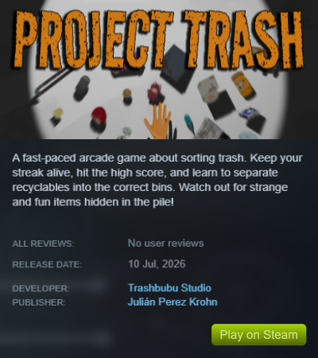
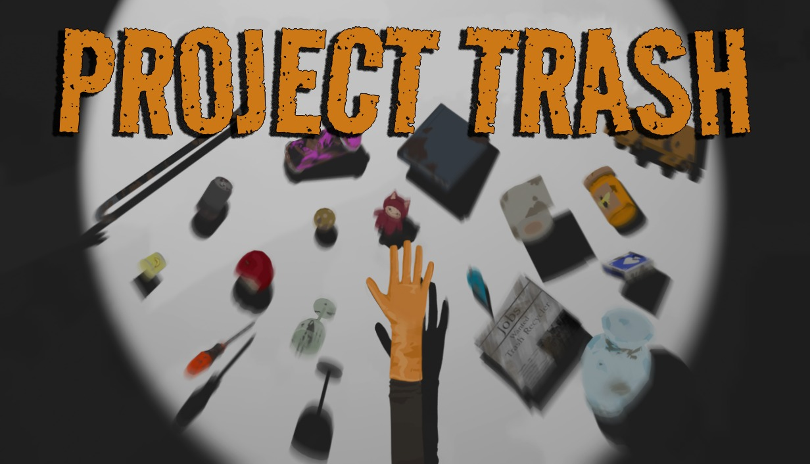
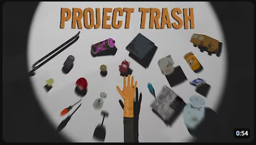
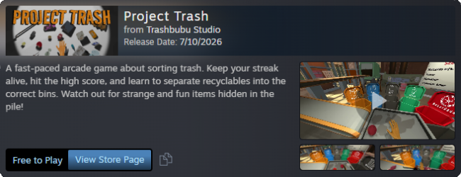
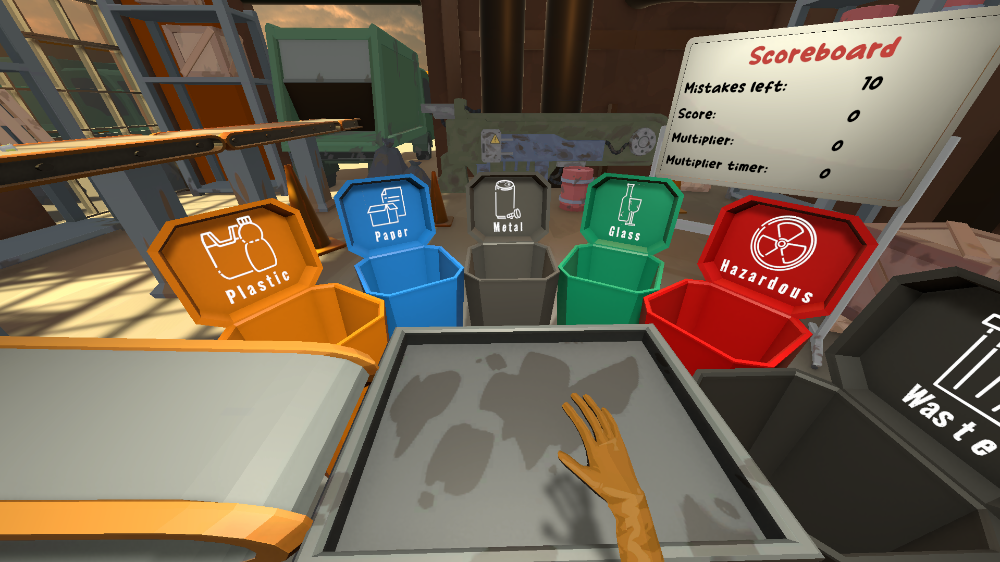
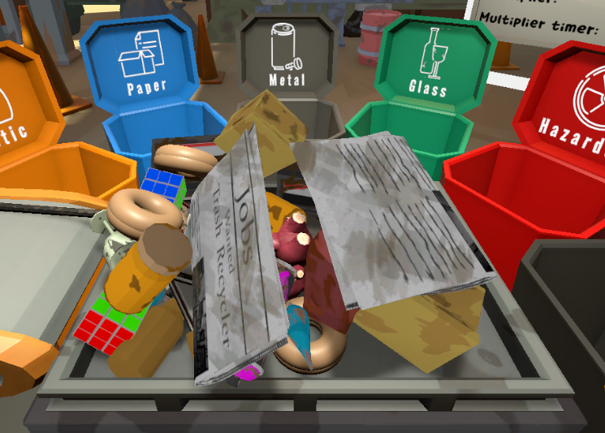
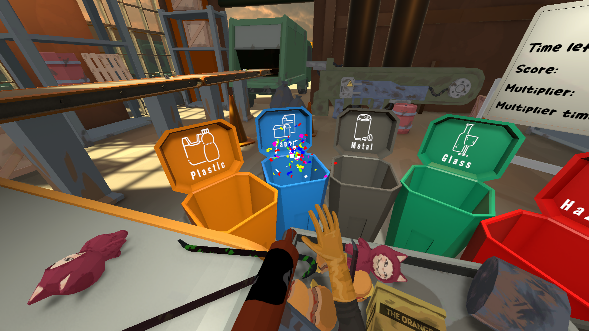
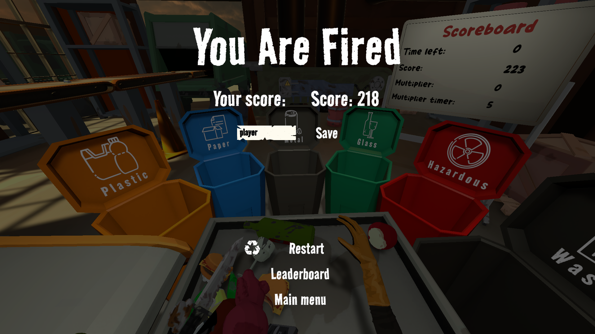

  <aside class="sidebar">
    <a href="index.html" class="btn-back">← Back to portfolio</a>

    

    

      <h2>Project Trash</h2>
      
Endless Arcade Sorting

    

    

      <a href="https://store.steampowered.com/app/4798760/Project_Trash/" target="_blank" rel="noopener noreferrer" class="btn btn-primary">
        Download on Steam ↗
      </a>
      <a href="https://futuregames.itch.io/projecttrash" target="_blank" rel="noopener noreferrer" class="btn btn-outline">
        Play on itch.io ↗
      </a>
      <a href="https://www.youtube.com/watch?v=0NN_dksL3Lo" target="_blank" rel="noopener noreferrer" class="btn btn-outline">
        Watch Teaser Trailer ↗
      </a>
    

    

      <h3>Quick Overview</h3>
      

        Project Trash is a fast-paced arcade game combining engaging sorting mechanics with an educational recycling message. Guided 13 developers as Product Owner over a 3-week sprint.
      

    

    

    

      <h3>Teaser Trailer</h3>
      
    

  </aside>

  <main class="content">
    <section>
      

        <h1>Project Trash</h1>
        
An Endless Arcade Sorting Game

        

          

            Engine
            Unity
          

          

            Role
            Product Owner / Game Designer
          

          

            Timeline
            3 weeks (13 developers)
          

          

            Genre
            Arcade / Time Management / Survival
          

        

      

      

        
      

      <h2>Gameplay Loop</h2>
      

        Players observe incoming waste items on a conveyor belt, quickly identify their material composition, grab them, and toss them into the matching recycling container. As the round progresses, conveyor speed accelerates and item flow intensifies, demanding rapid decision-making. Mistakes or dropped waste cause trays to overflow, eventually triggering a game over.
      

      <h2>Design Pillars</h2>

      

        <h4>Design Problem</h4>
        
How can recycling be transformed into a dynamic arcade experience that is simultaneously fast-paced, intuitive, and educational?

      

      

        <h4>Readability & Multi-Layer Identification</h4>
        

          Every item was modeled after real-world objects with recognizable materials: yellow for plastic, blue for paper, gray for metal, green for glass, red for hazardous waste, and black for general refuse. To reinforce instant readability, each recycling container displays its title, an icon, and a dynamic spotlight cueing the player.
        

      

      

        <h4>Accessibility-First Thinking</h4>
        

          Color palettes were chosen based on contrast research to remain distinct for colorblind players. Rather than relying solely on color recognition, the game integrates secondary and tertiary identifiers (shapes, labels, spotlights) and includes dedicated accessibility settings calibrated to standard color vision deficiency profiles.
        

      

      

        <h4>Sensory Feedback & Dynamic Audio</h4>
        

          Every item triggers distinct haptic sound effects on pickup and release. Correct sorting spawns confetti bursts, while sustained streaks build an adaptive combo system where musical layers progressively intensify with player performance.
        

      

      

        <h4>Humor & Easter Eggs</h4>
        

          To keep the mood lively, the trash stream contains playful gaming references: "The Orange" cardboard box (Metal Gear), a green-slimed crowbar (Half-Life), and our mascot parody "Trashbubu."
        

      

      <h2>Industry Jury Review & Results</h2>
      

        After the 3-week production sprint, Futuregames invited a jury of industry professionals to playtest and evaluate Project Trash.
      

      <ul>
        <li><strong>Playability:</strong> Jurors praised the core loop, noting players grasped mechanics immediately and stayed engaged chasing higher combos.</li>
        <li><strong>Accessibility:</strong> The accessibility considerations and multi-sensory feedback loops received special commendation.</li>
        <li><strong>Critique & Scope:</strong> Reviewers noted slight friction between educational realism and comedic items where waste categorization was humorous rather than scientifically exact.</li>
      </ul>

      <h2>In-Game Screenshots</h2>
      

        
        
        
        
      

    </section>
  </main>

