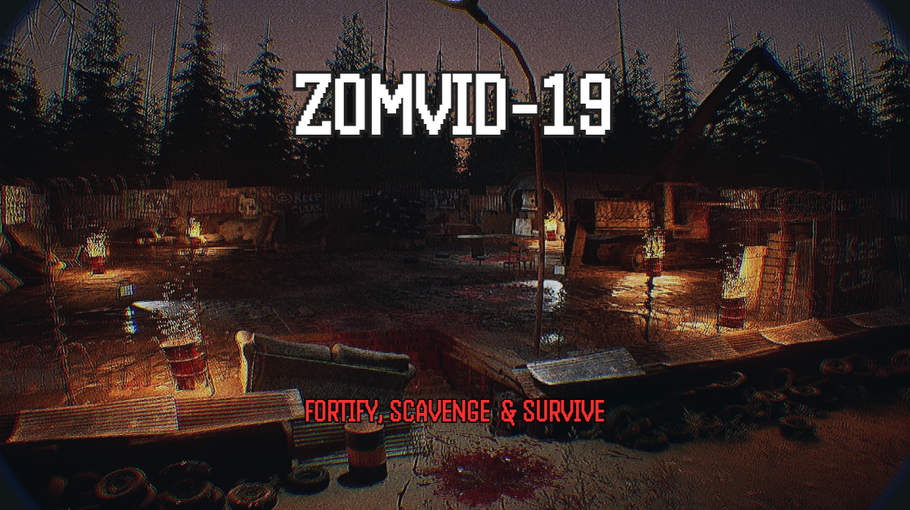
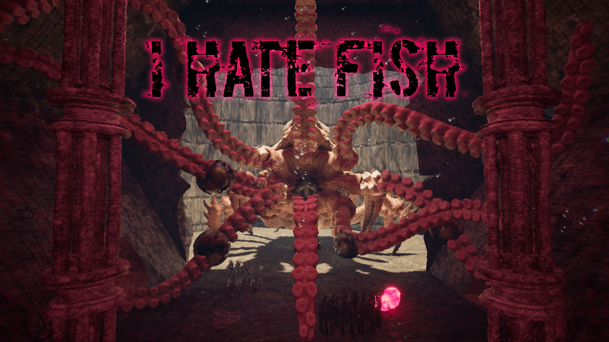
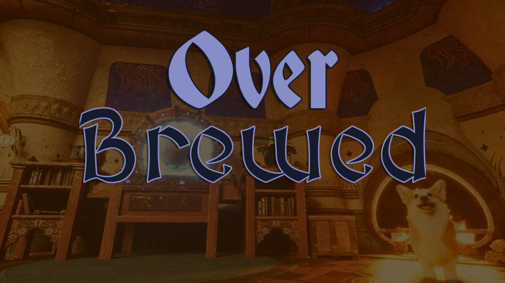

  <aside class="sidebar">
    

      

        
        Game Designer & Developer
      

      <h1>Julián Perez Krohn</h1>
      

        Moved from Argentina to Poland to pursue a professional career in game development.
      

    

    

    

      <h3>Background & Interests</h3>
      <ul>
        <li><strong>Game Design student</strong> at Futuregames Warsaw</li>
        <li>Software Developer (7 years of experience)</li>
        <li>Tabletop RPG enjoyer and Dungeon Master since 2021</li>
        <li>Hardcore PC gamer & board game aficionado</li>
        <li>Medieval fencing enthusiast</li>
      </ul>
    

    

      <a href="https://linktr.ee/jpkrohn97" target="_blank" class="btn btn-outline" style="width: 100%; justify-content: center;">
        Linktree Profile ↗
      </a>
      <a href="https://jpkrohn97.itch.io" target="_blank" class="btn btn-primary" style="width: 100%; justify-content: center;">
        itch.io Games ↗
      </a>
    

    

      
More about me

      

        

          I'm 28 years old, born and raised in Argentina, and surrounded by games since childhood. From playing card games with grandparents and boardgames with cousins, to playing sports at school and videogames with friends; I have always been a fan of the social interactions that come out of playing games: competitiveness, cooperation, deception, and most importantly, <strong>joy</strong>.
        

        

          I've been thinking of making games since I was 13, and slowly but surely, I'm moving forward with the objective of entering the industry to develop my professional skills, gain valuable experience, and build connections. My ultimate goal is making an impact on both the industry and the world. I believe the best games aren't remembered because of what players did, but because of how those experiences made them feel and the stories they created along the way.
        

        
        <blockquote>
          *Me as Harrier Du Bois from Disco Elysium, on Halloween 2025.
        </blockquote>

        <h3 style="margin-top: 1.5rem;">Favourite videogames</h3>
        

          
          
          
          
        

        <h3 style="margin-top: 1.5rem;">Favourite boardgames</h3>
        

          
        

      

    

  </aside>

  <main class="content">
    <!-- Games Highlights Section -->
    <section>
      

        <h2>Games Highlights</h2>
        
Featured game design case studies, mechanics breakdowns, and development post-mortems.

      

      

        <!-- 1. Zomvid-19 -->
        

          

            
          

          

            PO & Game Design / UE5.8
            <h3 style="margin-top: 0.5rem;"><a href="zomvid-19.html">Zomvid-19</a></h3>
          

          

            First-person zombie defense team project in Unreal Engine 5.8. Led production as Product Owner & Game Designer, designing player-driven barricade systems, illumination, and loot economy.
          

          

            <a href="zomvid-19.html" class="my-link">Read Case Study →</a>
          

        

        <!-- 2. I HATE FISH -->
        

          

            
          

          

            LD & Game Design / UE5.4
            <h3 style="margin-top: 0.5rem;"><a href="i-hate-fish.html">I HATE FISH</a></h3>
          

          

            Underwater FPS boss prototype team project in Unreal Engine 5.4. Sized 3D space metrics, custom swim stroke impulse mechanics, and Atlantis ruin level pacing.
          

          

            <a href="i-hate-fish.html" class="my-link">Read Case Study →</a>
          

        

        <!-- 3. OverBrewed -->
        

          

            
          

          

            PO & Game Design / UE5.7
            <h3 style="margin-top: 0.5rem;"><a href="overbrewed.html">OverBrewed</a></h3>
          

          

            Asymmetrical two-player co-op potion brewing team project in Unreal Engine 5.7 where verbal communication, role division, and physical handling reign.
          

          

            <a href="overbrewed.html" class="my-link">Read Case Study →</a>
          

        

        <!-- 4. No* Animal Crossing -->
        

          

            
          

          

            Lane Defense / Arcade
            <h3 style="margin-top: 0.5rem;"><a href="NoAnimalCrossing.html">No* Animal Crossing</a></h3>
          

          

            Inverting Frogger's core premise: players control traffic to defensively eliminate crossing animals with satisfying skill-shots and lane control.
          

          

            <a href="NoAnimalCrossing.html" class="my-link">Read Case Study →</a>
          

        

        <!-- 5. Project Trash -->
        

          

            
          

          

            Product Owner / Arcade
            <h3 style="margin-top: 0.5rem;"><a href="ProjectTrash.html">Project Trash</a></h3>
          

          

            Fast-paced arcade recycling game combining educational design pillars with responsive sensory feedback. Published on Steam and itch.io.
          

          

            <a href="ProjectTrash.html" class="my-link">Read Case Study →</a>
          

        

        <!-- 6. Necromeowcy -->
        

          

            
          

          

            City Builder / Jam
            <h3 style="margin-top: 0.5rem;"><a href="Necromeowcy.html">Necromeowcy</a></h3>
          

          

            Strategic city builder made in a one-week game jam featuring necromancy for the common good, living vs. undead workforce, and economy modeling.
          

          

            <a href="Necromeowcy.html" class="my-link">Read Case Study →</a>
          

        

      

    </section>

    <!-- TTRPGs and Dungeon Master Section -->
    <section>
      

        <h2>TTRPGs and Being a Dungeon Master</h2>
        
Storytelling, encounter balancing, dynamic pacing, and interactive worldbuilding since 2021.

      

      

        

          <h3>Systems Played & DMed</h3>
          <ul>
            <li>Dungeons & Dragons 5e (2014 & 2024 editions)</li>
            <li>Pathfinder 2e</li>
            <li>Shadow of the Demon Lord</li>
            <li>Daggerheart</li>
            <li>Vampire: The Masquerade (20th Anniversary Edition)</li>
          </ul>
          
          <blockquote>
            After a long and rushed D&D online campaign, Descent into Avernus, we met with the party to have the final showdown in person.
          </blockquote>
        

        

          <h3>Adventures Run as DM</h3>
          <ul>
            <li>Descent into Avernus (D&D 5e)</li>
            <li>Death Pit of Molloch (D&D 5e)</li>
            <li>Grim Hollow [1-3] (D&D 5e)</li>
            <li>The Lost Kenku & The Wild Sheep Chase (D&D 5e)</li>
            <li>Dead by Dawn, Fine Country Folk, Tales of the Desolation (Shadow of the Demon Lord)</li>
            <li>The Sablewood Messengers (Daggerheart)</li>
          </ul>
          
        

      

    </section>
  </main>

