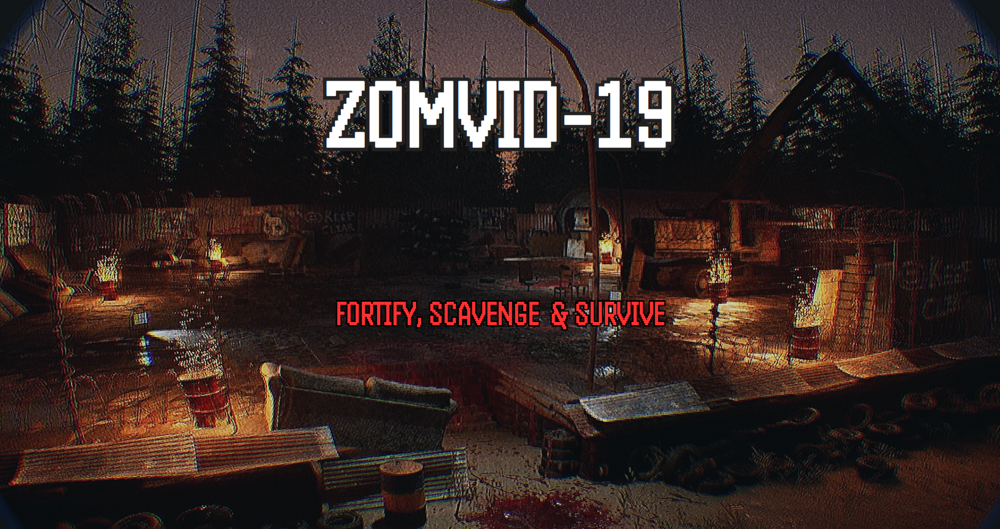

  <aside class="sidebar">
    <a href="index.html" class="btn-back">← Back to portfolio</a>

    

    

      <h2>Zomvid-19</h2>
      
Fortify, Scavenge & Survive

    

    

      <h3>Quick Overview</h3>
      

        Survive the apocalypse by preparing your base defenses during the day to hold off relentless zombie hordes at night. An intense first-person survival experience developed in <strong>Unreal Engine 5.8</strong>.
      

    

  </aside>

  <main class="content">
    <section>
      

        <h1>Zomvid-19</h1>
        
First-Person Zombie Survival & Player-Driven Barricade Defense

        

          

            Engine
            Unreal Engine 5.8
          

          

            Roles
            Product Owner, Game Designer
          

          

            Genre
            FPS / Survival-horror / Sandbox
          

        

      

      <h2>Game Overview & Premise</h2>
      

        Conceived from an original prototype concept, <strong>Zomvid-19</strong> (internally developed as <em>Zombie Fortress</em>) is an FPS zombie defense experience centered around player-driven physical fortification. Players must scavenge randomized loot and fortify their compound in daylight, because once the sun sets, the infected swarm with deadly aggression.
      

      <h2>Core Design Pillars & Systems</h2>

      

        <h4>1. Player-Driven Fortification & Barricade Physics</h4>
        

          Unlike static-cover shooters, players actively build their own perimeter defense. Grab furniture, drag it to doorways, and physically nail them in place to build resilient barricades. Place deadly defensive traps to halt advancing waves.
        

      

      

        <h4>2. Day & Night Survival Loop</h4>
        

          Strategic tension is governed by a strict circadian cycle:
        

        <ul>
          <li><strong>Daylight Phase:</strong> Tactical calm dedicated to scouting, gathering randomized loot drops, "boarding up windows", and tuning power distribution.</li>
          <li><strong>Night Phase:</strong> High-stress combat trial where aggressive horde waves assault player's fortress.</li>
        </ul>
      

      

        <h4>3. Power Management & Illumination Blueprints</h4>
        

          Darkness is a lethal hazard. Players must manage their base's electrical generator and power supply via the Power Menu to keep spotlights active. Alternatively, light barrels on fire to light up the perimeter, giving players sightlines on advancing infected.
        

      

      

        <h4>4. Scavenging & Dynamic Loot System</h4>
        

          The Loot Manager dynamically spawns items, ammunition, and crafting materials across the compound so that every survival run yields distinct tactical choices. Exploration is rewarding but takes time that one would spend fortifying home.
        

      

      <h2>Production Leadership & Team Credits</h2>
      

        As Product Owner, Team Leader, and Producer, I guided the project from concept to Gold release: initialized the Unreal Engine project and GitHub repository, authored the GDD on Miro, ran daily agile standups, built the tutorial level, edited audio and video, and balanced core Blueprints.
      

      

        

          Product Owner & Team Lead
          Julián Perez Krohn
        

        

          Producers
          Camilla Davel Braga, Alex Loubenets
        

        

          Designers
          Julián Perez Krohn, Gargeya Deshmukh, Nikoloz Ninua
        

        

          Programmers
          Theo Choicoski, Ozan Turp, Sandee Srisawat
        

        

          Artist
          Nadir Zahim
        

        

          Special Thanks
          Mateusz Swarc
        

      

      <blockquote>
        "Leading Zomvid-19 reinforced the importance of clear design pillars: marrying physical barricade mechanics with power and lighting management transforms a simple wave shooter into a tense, tactical survival defense." — Julián Perez Krohn
      </blockquote>
    </section>
  </main>

